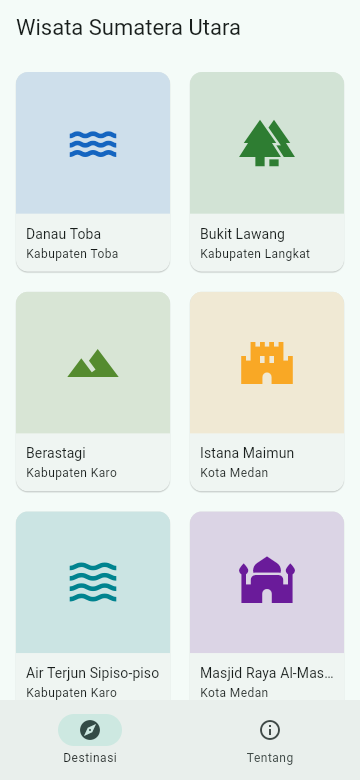
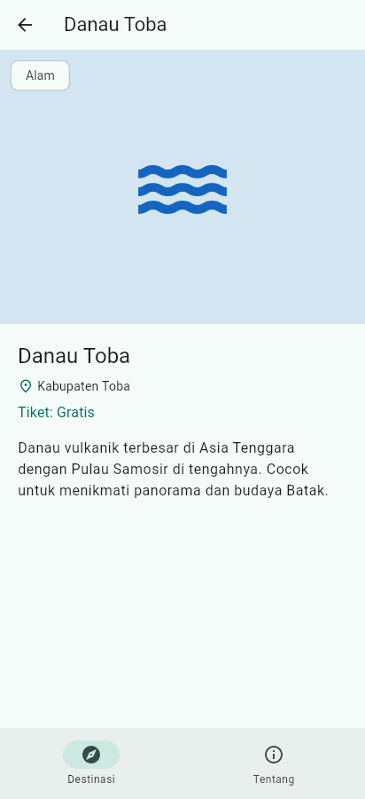
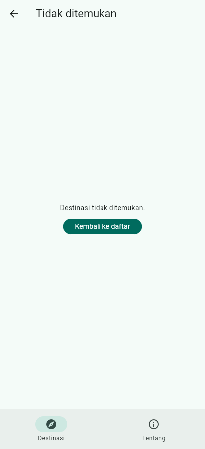
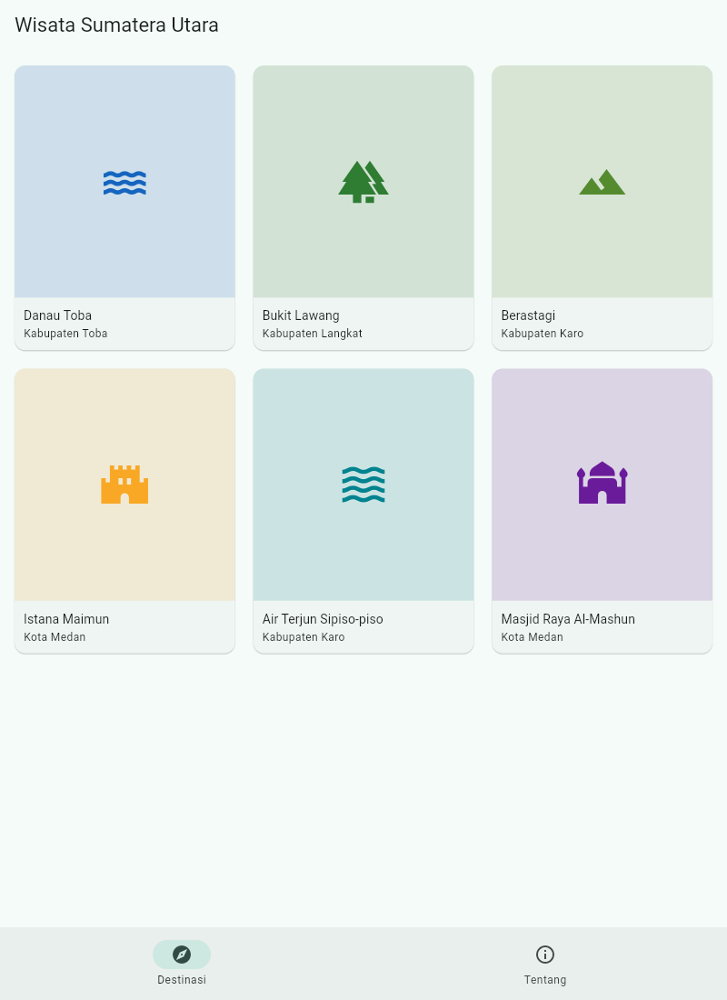
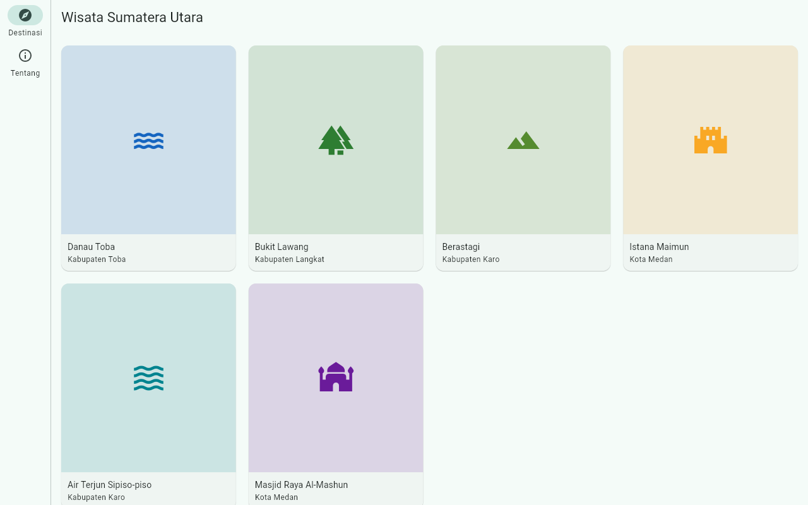
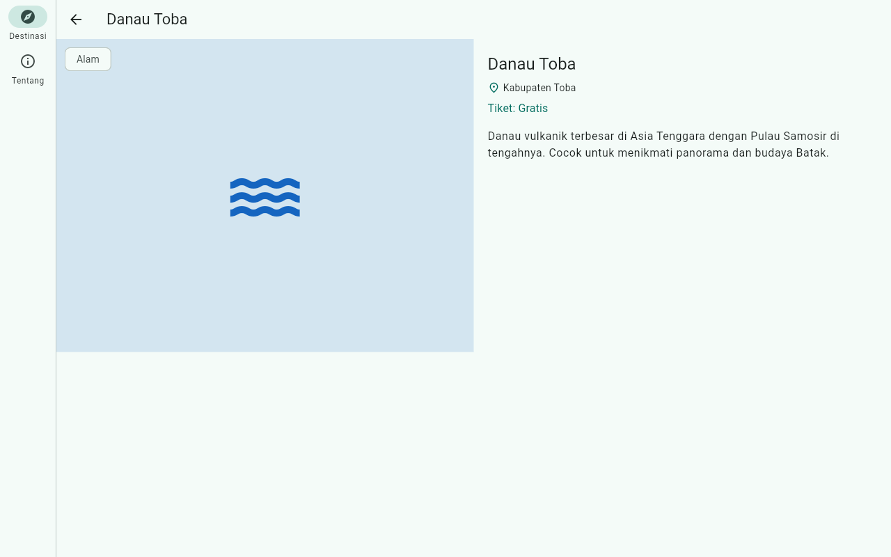

# Tugas Rutin 6 — Aplikasi Wisata Sumatera Utara

Pemrograman Mobile (3KOM40215) · Pertemuan 6 · Ilmu Komputer UNIMED

Panduan enam destinasi wisata Sumatera Utara yang menyesuaikan tata letak dengan lebar layar. Harga tiket adalah perkiraan untuk contoh aplikasi.

## a. Identitas

| | |
|---|---|
| Nama  | Muhammad Tsabat Muhyiyuddin |
| NIM   | 4243250002 |
| Kelas | PSIK24D |
| GitHub | [tsabat15](https://github.com/tsabat15) |

## Cara menjalankan

```
flutter pub get
flutter run -d chrome
flutter test
```

`flutter test` memeriksa tidak adanya overflow pada lebar 360, 412, 600, 768, 839, 840, 1024, dan 1280 dp, di halaman daftar maupun detail.

## b. Tangkapan layar

Diambil dari versi web di Chrome dengan ukuran jendela yang diatur untuk meniru ukuran ponsel dan tablet, bukan dari perangkat fisik.

| Ponsel (360 px): daftar, 2 kolom | Ponsel (412 px): detail vertikal | ID tidak dikenal |
|---|---|---|
|  |  |  |

**Tablet potret (800 px): 3 kolom, NavigationBar di bawah**



**Tablet lanskap (1280 px): 4 kolom, NavigationRail di samping**



**Tablet lanskap (1280 px): detail berdampingan, label kategori memakai Stack**



## c. Keputusan responsif

Saya memakai dua alat ukur sesuai cakupan keputusannya. `MediaQuery.sizeOf` dipakai di `KerangkaNavigasi`, karena letak navigasi menyangkut seluruh aplikasi dan bergantung pada lebar jendela. Batasnya 840 dp mengikuti window size class Material 3: di bawahnya `NavigationBar`, mulai 840 dp `NavigationRail`.

`LayoutBuilder` dipakai pada grid dan halaman detail, karena keputusan keduanya bersifat lokal dan bergantung pada ruang yang benar-benar tersedia. Ruang itu sudah berkurang oleh lebar rail, hal yang tidak diketahui `MediaQuery`. Grid memakai 2 kolom di bawah 600 dp, 3 kolom di bawah 900 dp, dan 4 kolom selebihnya. Halaman detail berdampingan mulai 700 dp dan vertikal di bawahnya.

Overflow dicegah dengan `Expanded` dan `TextOverflow.ellipsis` pada teks yang berada di dalam `Row`, serta `maxLines` pada kartu. `Stack` dipakai untuk menempatkan label kategori di atas gambar. Halaman detail memakai `SingleChildScrollView` pada susunan lebar dan `ListView` pada susunan sempit, sehingga deskripsi panjang tetap dapat digulir pada layar pendek. Tes otomatis memeriksa delapan lebar, termasuk 839 dan 840 dp sebagai titik pergantian navigasi, agar keputusan ini tidak hanya diuji dengan mata.

## d. Pernyataan penggunaan AI

Saya menggunakan asisten AI untuk membantu menulis kode, menyusun data destinasi, membuat tes, mengambil tangkapan layar, dan menyusun README ini. Saya bertanggung jawab memahami seluruh isinya dan akan memeriksa ulang data destinasi.
